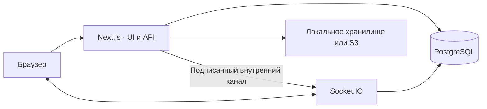

<div align="center">

# Ленканбан

**Внутренний сервис-деск: обращения, работа отделов и личное планирование в одном рабочем пространстве.**

[](https://github.com/impossi8le/kanban-service-desk/actions/workflows/ci.yml)


</div>

> **Коротко.** Заявки между отделами нужно вести в одном месте, а доступ к ним — разделять по отделам, ролям и доскам. Здесь канбан-доски, карточка обращения с перепиской и файлами, маршруты исполнения, уведомления и «Мой день» собраны в одном приложении с серверной проверкой доступа. Отличие от обычной канбан-доски — жизненный цикл обращения и идемпотентные команды: повтор запроса не создаёт второй результат.

**Ссылки:** [архитектура](docs/audit/ARCHITECTURE.md) · [вики проекта](docs/wiki/README.md) · [инженерные контракты](docs/engineering/README.md) · [состав публикации](docs/PUBLIC_SOURCE.md)

## Проблема

- Продажи, бухгалтерия и мастерские передают заявки через разные каналы: контекст, вложения и история оказываются в разных местах.
- В общей доске видно слишком много: личные черновики, внутренняя переписка и чужие заявки не должны попадать к каждому сотруднику.
- «Кто взял в работу», «что ждёт подтверждения» и «где застряло» приходится выяснять вручную.
- Повторное нажатие кнопки или повтор запроса после таймаута не должен создавать дубль заявки или сообщения.
- Администратору нужны отделы, группы, профили полномочий и права на конкретные доски — без правки кода.

## Что умеет

- Вести обращения по направлениям: доски, таблица, календарь, фильтры, поиск и архив.
- Хранить в карточке тему, описание, срочность, автора, исполнителя, наблюдателей, связанные обращения и историю изменений.
- Обсуждать заявку в её карточке, прикладывать документы и изображения; внутренние сообщения имеют отдельные ограничения видимости.
- Исполнять разрешённые действия по маршруту: доступность действия зависит от роли, доски и состояния заявки.
- Показывать ленту событий и счётчики по доскам и обращениям, отмечать прочитанное.
- Вести «Мой день» — личные записи по датам с календарём, сохранением и контролем конфликтующих изменений.
- Настраивать отделы, группы, профили полномочий и права на доски; разделять «увидеть», «создать» и «исполнять».
- Поддерживать рабочий маршрут «Безнал ОП»: «Ждут обработки» → «Со счётом» → архив, с подтверждением результата и возвратом на доработку с причиной.

### Пример рабочего процесса: «Безнал ОП»

Продажи создают заявку на счёт, бухгалтерия готовит документ, автор или сотрудник с соответствующим правом подтверждает результат. Возврат на доработку требует причины и сохраняет контекст обращения. Доступ к общей доске не отменяет ограничений персональных заявок и внутренней переписки.

## Стек

| Слой | Технологии |
|---|---|
| Интерфейс | React 19, TypeScript 5.8, Tailwind CSS 4, Radix UI, dnd-kit, TipTap |
| Веб-приложение | Next.js 15 App Router, NextAuth 4, server actions и HTTP handlers |
| Данные и формы | TanStack Query 5, React Hook Form, Zod 4 |
| База данных | PostgreSQL, Prisma 6.19 |
| Realtime | Socket.IO 4.8, отдельный Node-процесс |
| Диагностика | Pino, Sentry, Activity для истории бизнес-действий |
| Проверки | Vitest 4, Testing Library, Playwright, jest-axe, Lighthouse, ESLint, TypeScript |

## Как это устроено

Приложение состоит из веб-сервера Next.js и отдельного сервера Socket.IO. PostgreSQL хранит бизнес-данные, API-токены и счётчики ограничения запросов; файлы размещаются в локальном приватном каталоге или S3-совместимом хранилище.



**Границы.** HTTP-запрос подтверждает запись в БД; Socket.IO сообщает об изменении, но не является журналом событий. Доставка через HTTP-мост ограничена таймаутом в одну секунду, ошибки только журналируются. После потери соединения состояние восстанавливается чтением API — клиент не должен считать событие гарантированно доставленным (`docs/audit/ARCHITECTURE.md`).

**Данные.** Бизнес-агрегат — проект; пользователь владеет проектом и/или входит через участие. У задачи есть каноническая колонка, ранг фиксированной длины и версия для конкурентных изменений. У сообщения чата — необязательный глобально уникальный `clientId` для повтора отправки. Схема допускает несколько исполнителей; отдельной очереди заданий или outbox в Prisma-схеме нет.

**Код.** Основные зоны: `src/app` — страницы и HTTP API, `src/components` — карточки и доски, `src/features/kanban` — перемещения, ранги, блокировки и версии, `src/features/my-day` — личный дневник, `src/lib` — доступ, команды и хранение, `src/socket` — комнаты и внутренний канал.

**Развёртывание.** `Dockerfile` содержит отдельные цели `runner` для Next.js standalone и `socket` для Socket.IO. PostgreSQL и приватное хранилище разворачиваются отдельно, внешний доступ — через reverse proxy и HTTPS. Публичные `NEXT_PUBLIC_*` значения задаются при сборке, серверные секреты — окружением при запуске. Обновление рабочей установки включает проверку схемы, резервную копию PostgreSQL и файлов, проверку восстановления, согласованное применение миграций и проверку обоих серверов после переключения. `db:push` и `db:reset` не являются процедурой обновления production.

### Модель данных

| Сущность | Что важно при изменении |
|---|---|
| `Project` | Владелец, `boardRevision`, флаг `dndV2Enabled`; каскадно удаляет задачи, колонки и участия |
| `ProjectMember` | Уникальная пара проект/пользователь; роль `MEMBER` или `PROJECT_ADMIN` |
| `ProjectColumn` | Уникальные `(projectId, position)` и `(projectId, workflowKey)`; удаление последней или непустой колонки блокируется |
| `Task` | Каноническая колонка, ранг фиксированной длины, уникальный в колонке, и `version` для конкурентных изменений |
| `ChatMessage` | Необязательный глобально уникальный `clientId`; вложения, реакции и прочтения — JSON |
| `Activity` | История на задаче, а не неизменяемый журнал аудита |
| `TaskMoveOperation` | Уникальный `operationId`, хеш запроса и сохранённый JSON ответа |

### Модель доступа

Один evaluator возвращает не только флаг, но и источник решения:

| Проверенные факты | Read | Write | Manage members | Источник |
|---|---|---|---|---|
| ADMIN | да | да | да | `global_admin` |
| Владелец проекта | да | да | да | `project_owner` |
| Участник с ролью PROJECT_ADMIN | да | да | да | `project_admin` |
| Участник с ролью MEMBER | да | да | нет | `project_member` |
| Нет проекта или участия | нет | нет | нет | `no_project_access` |

Уточнение для ответственной группы даёт только чтение доски (`responsible_group_read`). Оно не выдаёт запись, управление составом и не открывает личные черновики. Историческая особенность ADMIN fast path — он разрешает доступ, не читая проект, — задокументирована как известная семантика, а не как новое правило.

### CI

| Workflow | Что делает |
|---|---|
| `ci.yml` | e2e-smoke на pull request, матрица браузеров по расписанию, visual + accessibility, unit/typecheck/lint и опциональные интеграционные тесты |
| `e2e-regression.yml` | Функциональная регрессия в Windows-окружении |
| `visual-canonical.yml` | Канонические Linux-снимки для визуального сравнения |
| `redesign-production.yml` | Сборка production-архивов из проверенного исходника |

## Инженерные находки

1. **Квитанция команды вместо «надеюсь, не продублируется».** `PATCH /api/tasks/[id]` принимает `operationId`, `expectedVersion` и строгий набор изменений. В одной транзакции проверяются блокировки, свежая идентичность актора и права, затем создаётся `TaskCommandOperation` с уникальной парой `(actorId, operationId)` и SHA-256-отпечатком запроса. Повтор возвращает прежний ACK и не мутирует данные; тот же UUID с другим отпечатком даёт конфликт, а несовпадение `expectedVersion` — 409. No-op получает квитанцию без записи задачи и без инкремента версии (`docs/engineering/TASK_COMMAND_CONTRACT.md`).

2. **Перемещение как отдельная операция.** `TaskMoveOperation` хранит уникальный `operationId`, хеш запроса и сохранённый JSON ответа. Повтор возвращает тот же результат, а несоответствие тела считается конфликтом. Это защищает доску от двойного переноса при ретрае.

3. **Один чистый evaluator доступа.** `evaluateLegacyProjectAccess(actor, project)` не ходит в сеть и БД, не логирует и не мутирует входные объекты. Результат — `canRead`, `canWrite`, `canManageMembers`, каждый с причиной: `global_admin`, `project_owner`, `project_admin`, `project_member` или `no_project_access`. Приоритет детерминирован, а `src/lib/project-access.ts` остаётся единственным DB-адаптером. Доступ ответственной группы — отдельный источник `responsible_group_read`, который даёт только чтение и не повышает запись (`docs/engineering/ACCESS_POLICY_CONTRACT.md`).

4. **Разделение «вижу доску» и «вижу заявку».** Даже при доступе к общей доске списки, поиск и счётчики используют обязательный task-read predicate. Группа видит чужие отправленные заявки, но не личные черновики и не удалённые записи; изменение заявки проверяется lifecycle-механизмом, а не правом на доску.

5. **Честная деградация realtime.** Socket.IO вынесен в отдельный процесс и общается с вебом по подписанному внутреннему каналу. Если событие потеряно, интерфейс перечитывает состояние через API; событие — уведомление, а не источник истины. Это осознанный компромисс вместо обещания exactly-once доставки.

6. **Визуальная регрессия как отдельный контур.** CI сравнивает канонические Linux-снимки в 1440 px для светлой, тёмной и системной темы, отдельно гоняет e2e-smoke на PR и расширенную матрицу браузеров по расписанию. Доступность проверяется через jest-axe и Lighthouse, а не только вручную.

## Быстрый старт

Нужны Node.js 22.22.2+ ветки 22, npm и Docker Compose. PostgreSQL и Mailpit запускаются в контейнерах, Next.js и Socket.IO — на хосте.

```sh
git clone https://github.com/impossi8le/kanban-service-desk.git
cd kanban-service-desk
npm ci
cp .env.example .env
```

В PowerShell вместо последней команды: `Copy-Item .env.example .env`.

Шаблон `.env.example` настроен на локальную базу `kanban_local` по адресу `127.0.0.1:55432`. Замените placeholders `NEXTAUTH_SECRET` и `INTERNAL_EMIT_SECRET` двумя разными случайными значениями:

```sh
node -e "console.log(require('node:crypto').randomBytes(32).toString('hex'))"
```

Для `ATTACHMENT_LOCAL_DIR` задайте абсолютный путь к каталогу вложений и разрешите процессу Node.js запись в него.

```sh
docker compose -f compose.local.yaml up -d --wait
npm run prisma:generate
npx prisma migrate deploy
npm run dev -- --hostname localhost --port 3555
```

Откройте `http://localhost:3555/sign-up`, создайте тестовую учётную запись и войдите. Mailpit доступен на `http://localhost:8025`. Локальная регистрация создаёт обычного пользователя; организация, профили и доступ к доскам настраиваются отдельно. `localhost` нужно использовать последовательно в публичных URL приложения и Socket.IO — иначе не совпадут origin и cookie.

После входа доступны основные разделы приложения:

1. `/projects` — доски, таблица и календарь проектов.
2. `/my-tasks` — задачи текущего пользователя.
3. `/inbox` и `/messages` — уведомления и переписка.
4. `/analytics` — аналитика, `/settings` — настройки.
5. `/admin/*` — отделы, группы, полномочия и привязки.

### Проверки

```sh
npm run typecheck
npm run lint
npm test -- --maxWorkers=2 --exclude="tests/integration/**"
npm run test:mail
npm run build
```

| Команда | Назначение |
|---|---|
| `npm run test:watch` | Vitest в режиме наблюдения |
| `npm run test:integration` | Интеграционные проверки; только с отдельной разрешённой тестовой БД |
| `npm run test:e2e` | Сценарии Playwright; нужны браузеры и изолированное окружение |
| `npm run socket:build` | Сборка отдельного Socket.IO-сервера |

Unit/component-проверки и реальная интеграция с PostgreSQL проверяют разные границы. Для integration/E2E нужна отдельная тестовая база; моки не доказывают поведение PostgreSQL.

## Статус и ограничения

- **Лицензия не установлена**: репозиторий опубликован для ознакомления.
- Это публичный снимок внутреннего проекта, а не готовый продукт с демо-стендом. Живой демо-ссылки нет; презентация лежит в `docs/presentations/Lenkanban-product-case.pptx`.
- Чистый bootstrap с пустой базы требует отдельной проверки: в снимке нет `prisma/seed.ts` и команды создания первого администратора. Поэтому `db:seed` и `db:reset` не входят в инструкцию запуска.
- Визуальная проверка неполна: README фиксирует 134 проверенных PNG, тогда как канонической матрице не хватает 332 файлов. Полное прохождение визуальной регрессии не заявляется.
- Integration/E2E требуют изолированной базы и браузеров; CI-джоб интеграционных тестов помечен как опциональный и не заменяет ручную приёмку.
- Нет выделенного outbox или очереди: гарантия доставки realtime-событий не заявляется, источник истины — HTTP и PostgreSQL.
- Историческая документация в `docs/` сохраняет даты и открытые вопросы; `docs/PRODUCT_ROADMAP_2026-10-29.md` — планы, а не отчёт о завершённой реализации. Направления развития: претензии и ОЗОК, проверки поиска, общие шаблоны отделов, диагностика и ежедневная работа.
- Для исправлений нужен воспроизводимый сценарий; реальные обращения, переписка, документы, пароли и токены не должны попадать в issue, тестовые фикстуры и скриншоты.
- Продуктовое имя — «Ленканбан», GitHub-репозиторий — `kanban-service-desk`; `Dockerfile` и compose сохраняют внутреннее имя `lenkanban`.

## Документация

- `docs/audit/ARCHITECTURE.md` — карта кода, данные, инварианты и границы изменений.
- `docs/engineering/README.md` — индекс инженерных контрактов.
- `docs/engineering/TASK_COMMAND_CONTRACT.md` — версия, аудит и повтор команд задачи.
- `docs/engineering/ACCESS_POLICY_CONTRACT.md` — политика доступа и evaluator.
- `docs/engineering/RATE_LIMIT_CONTRACT.md` — ограничение запросов.
- `docs/engineering/MY_DAY_CONTRACT_2026-10-29.md` — контракт личного дневника.
- `docs/engineering/VISUAL_REGRESSION_CONTRACT.md` — правила визуального CI.
- `docs/REQUEST_LIFECYCLE.md` — жизненный цикл заявки.
- `docs/BOARD_CURRENT_WORKFLOW.md` и `docs/BOARD_TARGET_WORKFLOW.md` — текущий и целевой процессы доски.
- `docs/wiki/` — архитектура, разработка, эксплуатация, безопасность и каталог.
- `docs/PUBLIC_SOURCE.md` — состав исходников и назначение исторических документов.
- `deploy/RUNBOOK.md`, `deploy/PREFLIGHT.md`, `deploy/RELEASE_MANIFEST.md` — развёртывание и выпуск.
